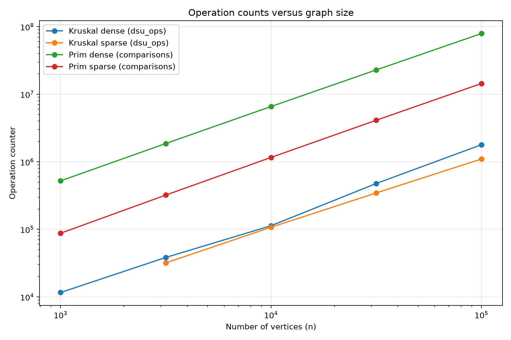
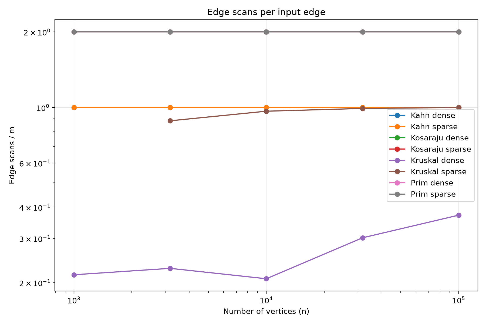
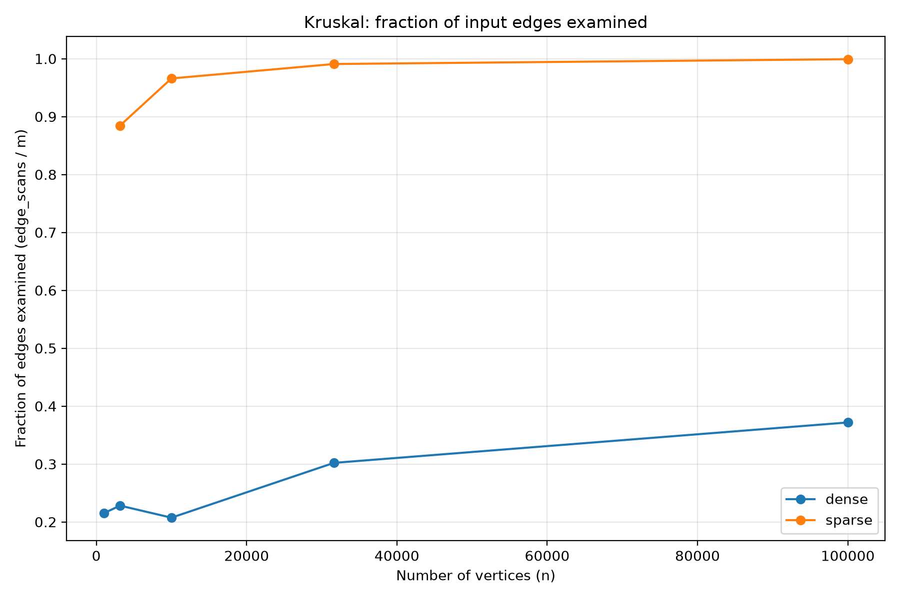

# DAA Assignment 3 — Graph Algorithms

## Overview

This project implements and analyzes graph algorithms as part of the Design and Analysis of Algorithms course.

The project focuses on Disjoint Set Union (DSU), Minimum Spanning Trees (MST), Strongly Connected Components (SCC), topological sorting, and shortest paths in Directed Acyclic Graphs (DAGs).

## Implemented Algorithms

- **DSU** — supports set union and find operations.
- **Kruskal's Algorithm** — finds a Minimum Spanning Tree using edge sorting and DSU.
- **Prim's Algorithm** — finds a Minimum Spanning Tree using a priority queue.
- **Kosaraju's Algorithm** — finds strongly connected components using iterative depth-first search.
- **Kahn's Algorithm** — performs topological sorting using vertex in-degrees.
- **DAG Shortest Paths** — calculates shortest paths in a directed acyclic graph.

## Project Structure

```text
DAA_Assignment3/
├── data/
│   ├── cyclic.txt
│   ├── dag.txt
│   └── disconnected.txt
├── results/
│   ├── plots/
│   │   ├── operations_vs_n.png
│   │   ├── scans_per_edge.png
│   │   └── kruskal_edge_fraction.png
│   ├── reference_check.txt
│   └── results.csv
├── src/
│   ├── main/java/
│   └── test/java/
├── generate_plots.py
├── pom.xml
└── README.md
```

## Technologies

- Java 17
- Maven
- JUnit 5
- Python 3
- Matplotlib

## Running the Tests

Open the project in IntelliJ IDEA and run the Maven `test` goal.

The unit tests cover DSU, graph file loading, MST algorithms, strongly connected components, topological sorting, and DAG shortest paths.

## Benchmark Results

Benchmark results are stored in `results/results.csv`.

The CSV contains the algorithm name, graph type, number of vertices (`n`), number of edges (`m`), execution time, operation counters, and algorithm result.

Reference comparisons are available in `results/reference_check.txt`.

## Performance Plots

Three plots are generated from the benchmark CSV:

### 1. Operation Counts vs. Graph Size



### 2. Edge Scans per Input Edge



### 3. Fraction of Edges Examined by Kruskal



## Generating the Plots

Install Python 3 and Matplotlib, then run:

```powershell
python -m pip install matplotlib
python generate_plots.py
```

The generated PNG files are saved in `results/plots/`.

## Author

DAA Assignment 3 — Design and Analysis of Algorithms
